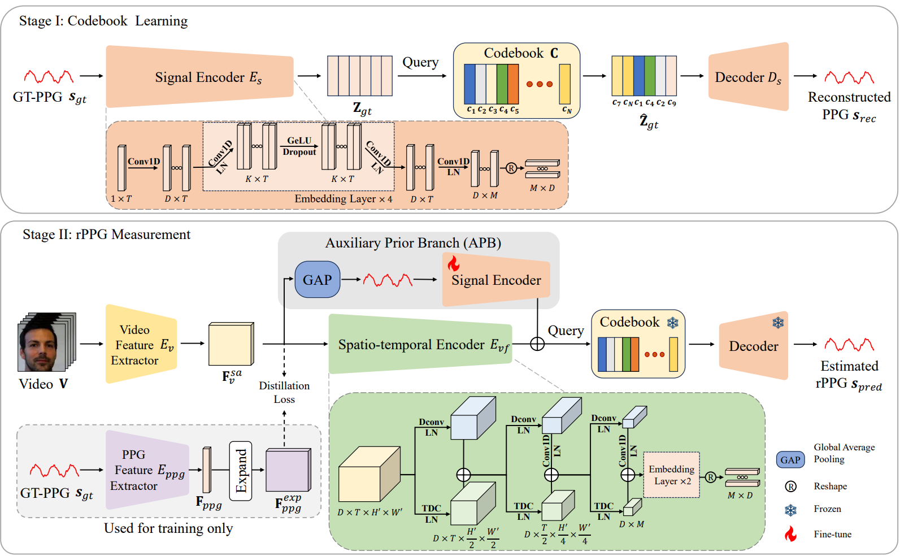

### CodePhys

---

#### Introduction

Main code of **CodePhys: Robust Video-Based Remote Physiological Measurement Through Latent Codebook Querying**



---

#### Reproduce our method

##### 1 video preprocess

- For any video dataset, we neet crop the face firstly, use:
```
python video_preprocess.py --dataset {dataset_name}
```

##### 2 dataset preprocess

- For any video dataset, we need prepare the dataset for training, use:
```
python dataset_preprocess.py --dataset_dir {dataset_dir} --dataset {dataset_name}
```

##### 3 train

- First, we need train a codebook by:
```
python code_rppgnet_trainer.py --save_root /path/to/save_dir/{dataset_name}_codebook --dataset {dataset_name}
```
- With a pretrained codebook, to start training with CodePhys on the corresponding dataset, use:
```
python codephys_trainer.py --save_path /path/to/save_dir/ --dataset {dataset_name} --codebook_model_path /path/to/save_dir/{log_name}/ckpt/model.pth
```

##### 4 test

- to test the model, ref. to `test_results.ipynb`

---

#### Cite our method

```
@ARTICLE{10878441,
  author={Chu, Shuyang and Xia, Menghan and Yuan, Mengyao and Liu, Xin and Seppänen, Tapio and Zhao, Guoying and Shi, Jingang},
  journal={IEEE Journal of Biomedical and Health Informatics}, 
  title={CodePhys: Robust Video-Based Remote Physiological Measurement Through Latent Codebook Querying}, 
  year={2025},
  volume={29},
  number={7},
  pages={4932-4945},
  keywords={Feature extraction;Videos;Interference;Visualization;Biomedical measurement;Physiology;Noise measurement;Signal resolution;Robustness;Bioinformatics;Discrete representation learning;heart rate;knowledge distillation;remote photoplet- hysmography},
  doi={10.1109/JBHI.2025.3540134}}
```

